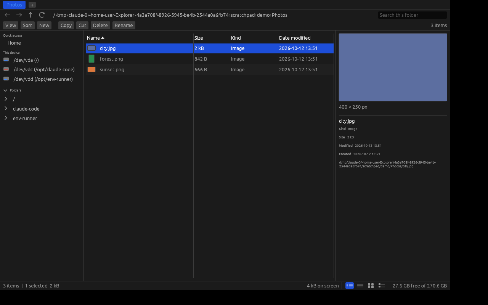

# Explorer

A native, cross-platform file manager written in Rust — Windows Explorer's feature set,
rebuilt to be faster, leaner and dependency-light.

Everything is drawn with [egui](https://github.com/emilk/egui) on a GPU surface: no
Electron, no web view, no bundled runtime. The whole UI, icons included, is vector-drawn
at runtime, so the binary ships without a single image asset and stays crisp at any
scale factor.



## What works today

**Browsing**
- Tabs, with middle-click close, duplicate, and `Ctrl+T` / `Ctrl+W`
- Back / forward / up with full per-tab history
- Clickable breadcrumbs; right-click a crumb for its subfolders; click the empty strip
  (or `Ctrl+L`) to type a path, with `~` expansion
- Navigation pane: quick access folders, pinned folders, mounted volumes with
  used-space bars, and a lazy folder tree
- Live refresh: the directory is watched and re-scanned when it changes, debounced
  so a busy download folder does not thrash

**Views**
- Details (sortable, resizable, virtualised columns), List, Icons and Tiles
- Icon size from 32 to 256 px, by slider or `+` / `-`
- Sort by name, size, kind, type, date modified or date created, ascending or
  descending, folders first optional
- Natural sort, so `file2` comes before `file10`
- Optional columns: size, kind, type, modified, created
- Image thumbnails decoded on a worker pool, cached, and bucketed by size so zooming
  reuses earlier decodes
- Preview pane: large image preview with pixel dimensions, text head for text and
  source files, metadata for everything else

**Doing things**
- Copy, cut, paste with Explorer-style ` (2)` collision naming
- Move to recycle bin, or delete permanently
- Rename (in place in Details, a dialog elsewhere), with the extension kept out of
  the initial selection
- New folder and new file
- Copy path, open in terminal, reveal in the OS file manager, open with the default app
- Properties, including a background-measured recursive folder size
- Drag files in from other applications
- Per-item and background context menus everywhere
- Long operations run on a worker thread with a progress bar and a cancel button

**Finding things**
- Type in the search box to filter the current folder as you type
- Press Enter to search subfolders recursively, with results streaming in
- `*` and `?` wildcards, so `*.rs` works
- Type-ahead: start typing in the listing to jump to a name

**Fit and finish**
- Dark, light or follow-the-system theme
- Settings, pinned folders and open tabs persist between runs
- Hidden items toggle (dotfiles on Unix, the hidden and system attributes on Windows)
- Status bar with item counts, selection size and free space on the volume
- `F1` lists every keyboard shortcut

## Why it is fast

- **Nothing blocks the frame.** Directory scans, recursive searches, folder
  measurements, thumbnail decoding and file operations all run on worker threads and
  report back over channels. Navigating into a directory with 100k entries does not
  stall the window.
- **Scans are parallel.** `stat` dominates the cost of listing a directory, so metadata
  is gathered across a Rayon pool.
- **Views are virtualised.** Details and Icons lay out only the rows on screen, so the
  row count barely affects frame time.
- **Filtering sorts indices, not entries.** Typing in the search box re-filters a
  `Vec<usize>` and never moves or clones an entry.
- **Thumbnails are bucketed and capped.** Requests round up to a fixed set of sizes so
  the zoom slider reuses decodes, and the cache evicts so a folder of 50k photos cannot
  exhaust memory.
- **Workers wake the UI.** Every background thread holds a repaint callback, so results
  appear immediately without the UI polling for them.

## Building

Requires a recent stable Rust toolchain (1.82+).

```sh
cargo run --release              # open the home folder
cargo run --release -- /some/dir # open a specific folder
```

Release binaries land in `target/release/explorer`.

Prebuilt binaries for Linux (x86_64, aarch64), macOS (Intel, Apple silicon) and
Windows (x86_64) are attached to every tagged release. To cut one, push a tag:

```sh
git tag v0.1.0 && git push origin v0.1.0
```

On Linux the usual X11/Wayland client libraries must be present
(`libxkbcommon-x11`, `libgl1`, and the X11 or Wayland runtime); Windows and macOS need
nothing beyond the toolchain.

```sh
cargo test              # unit tests
cargo clippy --all-targets
cargo fmt --check
```

## Layout

| Crate | What it holds |
| --- | --- |
| `crates/explorer-core` | Filesystem model: entries, scanning, sorting, filtering, navigation history, volumes, file operations, directory watching. No UI types anywhere. |
| `crates/explorer-thumbs` | Thumbnail decoding worker pool and its bounded cache. |
| `crates/explorer-ui` | The egui application: panels, views, dialogs, theming, and the `explorer` binary. |

The UI mutates nothing directly while drawing: widgets queue an `Action`, and the app
applies the queue once the frame's borrows are released. That keeps event handling in
one place and the views free of application state.

## Not there yet

- Video and PDF thumbnails (images only for now)
- Drag and drop *within* the window (dropping files in from other apps works)
- Per-folder view settings
- Network locations and archive browsing
- A full-resolution zoomable image viewer; the preview pane tops out at the cached
  thumbnail size
- Platform shell integration: no Windows jump lists, no OS-level file associations
  editing, no shell extension menus

## License

MIT or Apache-2.0, at your option.
